<p align="center">
  
</p>

<h1 align="center">Prophet</h1>

<p align="center">
  <strong>Ask your spreadsheets questions in plain language. Get checked numbers, charts and forecasts you can audit.</strong>
</p>

<p align="center">
  
  
  
  
  
</p>

<p align="center">
  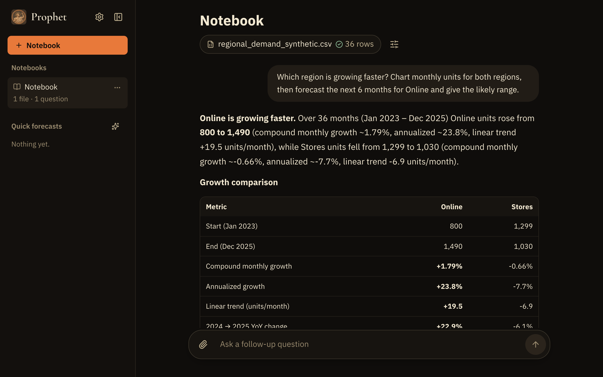
</p>

## Why Prophet

- **Answers show their working.** Every answer keeps the steps, the code that ran and what it printed. Nothing is a bare number.
- **Forecasts earn their place.** Each forecast is backtested against simple baselines on your own history, so you can see whether the model beats a naive guess.
- **Runs on your machine.** The server listens on loopback only. Your files stay local; the only outbound calls are planner requests to NVIDIA NIM.

## Real questions, real answers

These are unedited answers from Prophet. The datasets are synthetic demo files, so the figures are illustrative, not observed results.

<table>
<tr>
<td width="50%" valign="top">

**Forecast backtest with drivers.** Promotion and Christmas flags cut MASE from 0.717 to 0.499 on a three-year weekly series. The best simple baseline scores 1.246.

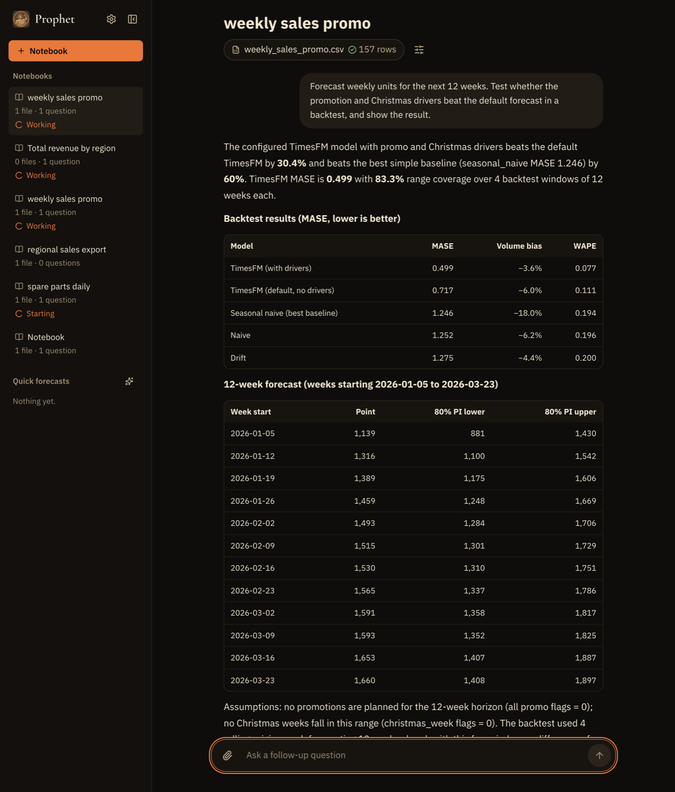

</td>
<td width="50%" valign="top">

**Anomaly hunt.** Fifteen unusual weeks, sorted into explained by promotions, explained by Christmas, and unexplained, each with the reason it was or was not explained.

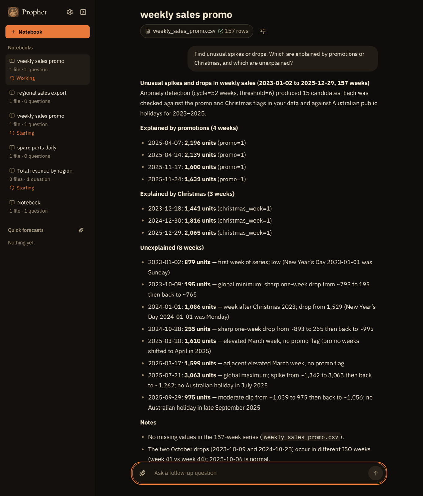

</td>
</tr>
<tr>
<td width="50%" valign="top">

**Cleaning a messy workbook.** A hidden sheet, a duplicate row and blank units are reported, then totals by region are computed from the cleaned table.

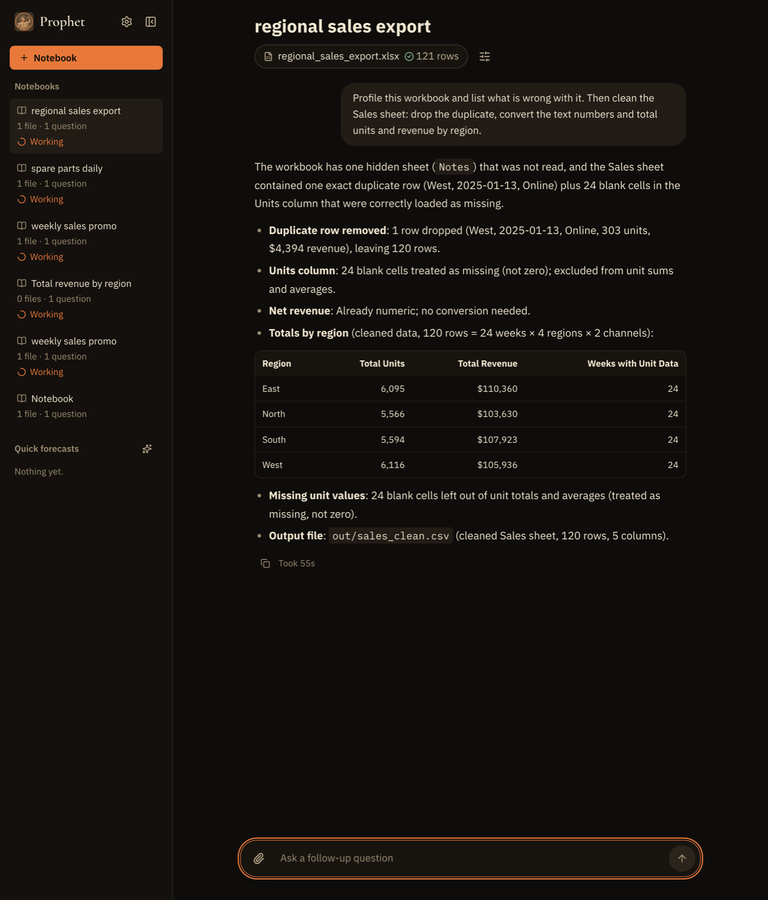

</td>
<td width="50%" valign="top">

**Reusing an earlier analysis.** A saved synthetic notebook reopens with its answer, growth table and six-month forecast intact.

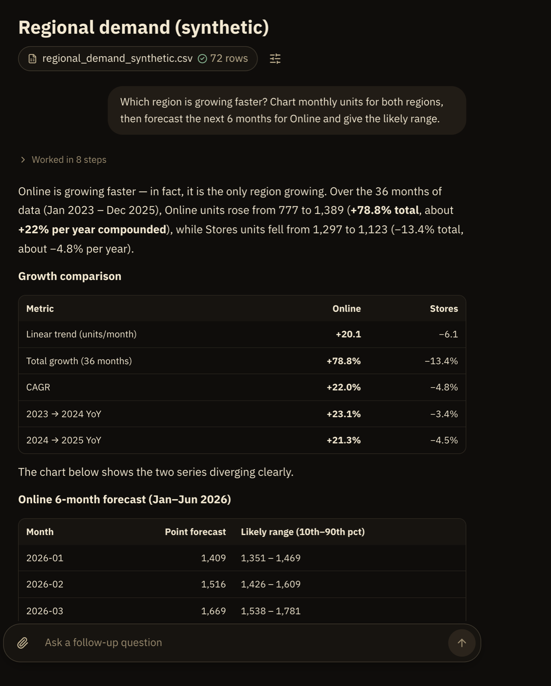

</td>
</tr>
</table>

## Features

### Ask in plain language

Drop in one or more spreadsheets and ask. Totals, comparisons, trends, joins across files and cleaning all work from the same notebook, which remembers its files and earlier answers.

Supported inputs: CSV, Excel (`xlsx`, `xlsm`, `xlsb`, `xls`), OpenDocument, Parquet and zipped bundles. Hidden sheets, title rows, merged headers and several tables on one sheet are detected and reported, never silently guessed. A damaged or password-protected file is flagged in words, not dropped.

<p align="center"></p>

### Forecasts with a baseline check

TimesFM 3 produces a point forecast and an 80% likely range. Prophet also scores the same method against a naive baseline on the last windows of your history, and says so when the model does not win.

<p align="center"></p>


### Charts that make one point

Each chart shows the history, the forecast and its likely range, and marks any promotion or Christmas weeks it was given. The numbers behind every chart are saved beside it as a CSV.

<p align="center">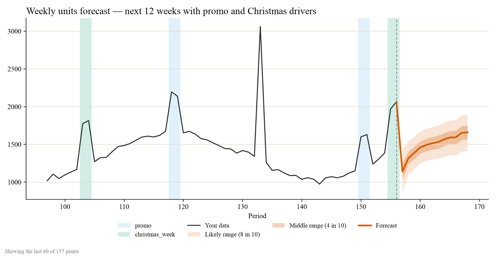</p>

<table>
<tr>
<td width="50%" valign="top">

**Intermittent demand.** Weekly units for a spare part that is often zero. The expected demand from a method built for sparse demand (TSB) is set against the 52-week average. Synthetic demo data.

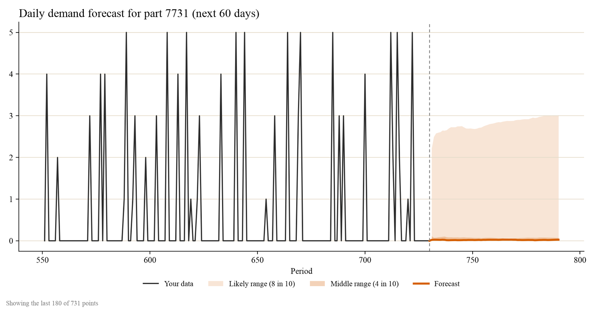

</td>
<td width="50%" valign="top">

**Two channels over three years.** Monthly units for Online and Stores, from a saved synthetic analysis.

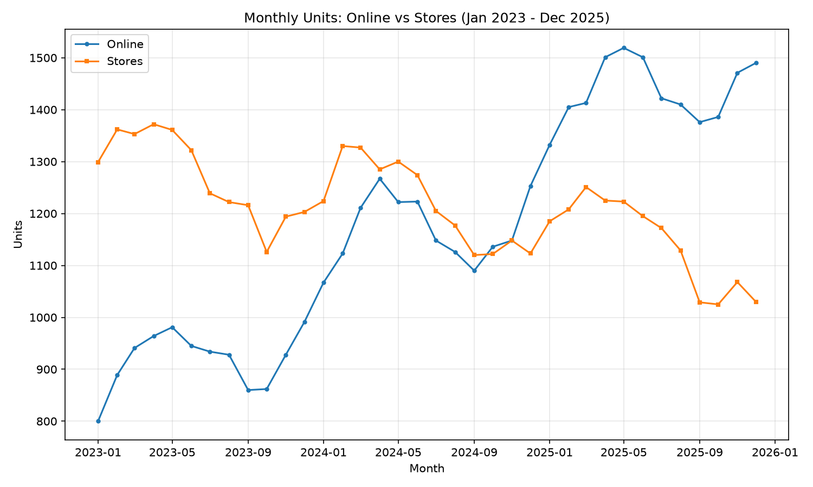

</td>
</tr>
<tr>
<td width="50%" valign="top">

**Six-month forecast.** The Online series with its point forecast and likely range.

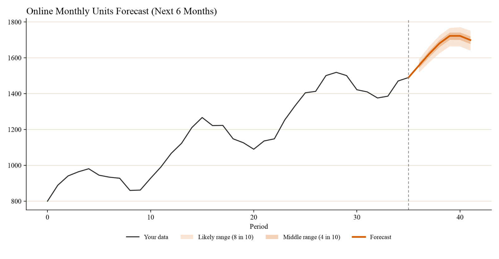

</td>
<td width="50%" valign="top">

**Large file, charted.** Monthly revenue for 2024, computed from a 1.1 million row file.

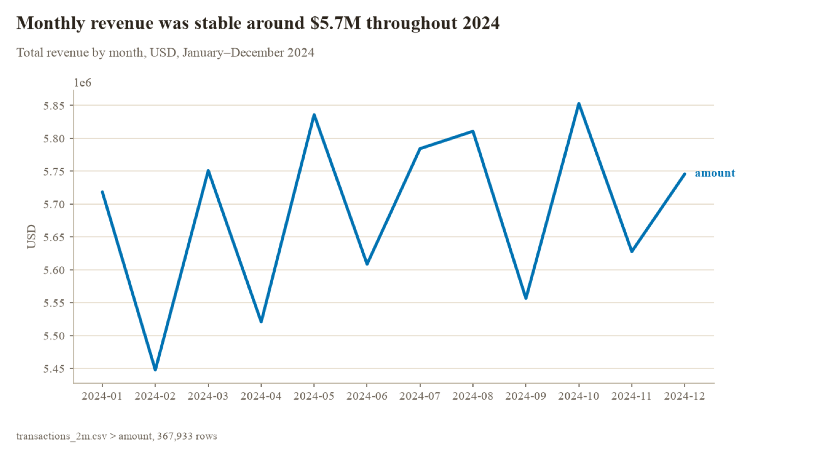

</td>
</tr>
</table>

### Large files

Uploads take files up to 50 MB. A CSV or Parquet file with more than 500,000 rows is not loaded whole: it is queried where it sits, and only the small grouped result comes back. Totals come from every row, not a sample.

### Keep what matters

Cleaned tables are saved as versions you can download as CSV and reuse in later questions. Forecast packs come as PNG and SVG charts, an XLSX workbook, a DOCX report and a PDF, all listed with a SHA-256 manifest.

### Use it from other agents

Claude, Cursor, ChatGPT-style tools and scripts can drive Prophet over HTTP or MCP. See [API.md](API.md).

## Quick start

**Requirements**

- Python 3.12 and [uv](https://docs.astral.sh/uv/)
- Node.js, to build the web console
- An NVIDIA NIM API key, for the planner
- Apple silicon: the TimesFM 3 runtime is installed through MLX (`timesfm[mlx]`), so the install needs it.

**Install and run**

```bash
uv venv --python 3.12 .venv && source .venv/bin/activate && uv pip install -e ".[dev]"
cp .env.example .env              # add at least one NVIDIA_NIM_API_KEY_n
(cd web && npm install && npm run build)
PYTHONPATH=src python -m prophet_agent.api
```

Open <http://127.0.0.1:8010>, choose **Notebook**, attach a file and ask a question.

The port is set by `PROPHET_API_PORT`. Data lives in `data/` by default; set `PROPHET_HOME` to move it, for example to try Prophet on a scratch folder.

## How it works

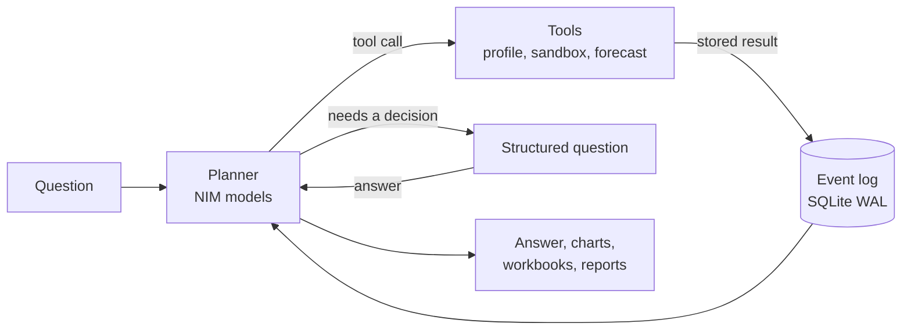

A durable goal loop plans, acts and evaluates. Each model decision and tool result is stored before the run moves on, so an interrupted run resumes without asking the model again for finished work, and a finished tool call is never repeated. Analytics code runs in a restricted child process with read-only inputs and a time limit; everything it writes is listed with a checksum.

## Project layout

| Area | Location |
|---|---|
| Model access, key pool, failover, schema-bound output | `src/prophet_agent/nim/` |
| Durable runtime, event log, ledger, questions | `src/prophet_agent/runtime/` |
| Notebooks, sources, kept tables | `src/prophet_agent/notebooks.py` |
| Forecast maths and TimesFM 3 | `src/prophet_agent/forecast/` |
| Tools the agent calls | `src/prophet_agent/tools/` |
| Sandboxed analytics and artefacts | `src/prophet_agent/sandbox/`, `src/prophet_agent/artifacts/` |
| Versioned prompt contracts | `src/prophet_agent/prompts/` |
| HTTP API and MCP bridge | `src/prophet_agent/api/`, `src/prophet_agent/mcp_server.py` |
| Web console | `web/` |

## Documentation

- [API.md](API.md): HTTP routes and the MCP server.
- [docs/prophet/ARCHITECTURE.md](docs/prophet/ARCHITECTURE.md): locked design decisions, including the licence gate.
- [docs/prophet/GOAL.md](docs/prophet/GOAL.md): completion criteria and the evidence behind them.

## Development

```bash
scripts/check.sh            # offline gate: unit and API tests, no real model
scripts/check.sh --real     # also the real TimesFM 3 tests (Apple silicon, cached weights)
cd web && npx tsc --noEmit && npm run build
```

Please run the offline gate and the web typecheck before opening a pull request. [CLAUDE.md](CLAUDE.md) has the working conventions used in this repository.

## Licence and notices

- **Project licence:** Apache License 2.0, see [LICENSE](LICENSE). Copyright 2026 Dang Khoa Le.
- **TimesFM 3 weights** are released for non-commercial research use. Do not use outputs for commercial decisions, client deliverables or paid services. The licence gate is in [docs/prophet/ARCHITECTURE.md](docs/prophet/ARCHITECTURE.md).
- **Analytics sandbox:** a guardrail, not isolation. Open only files you trust.
- **Examples:** the screenshots use a synthetic dataset, and figures from the built-in data generator are synthetic.
