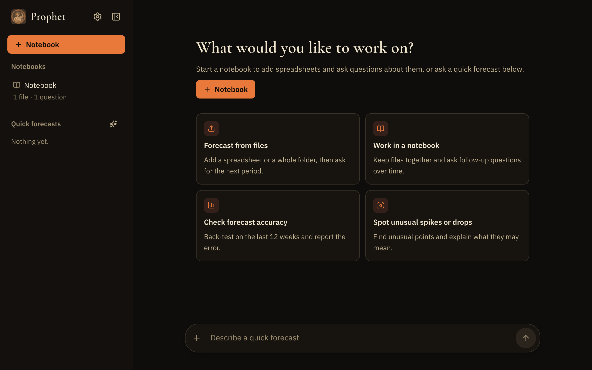
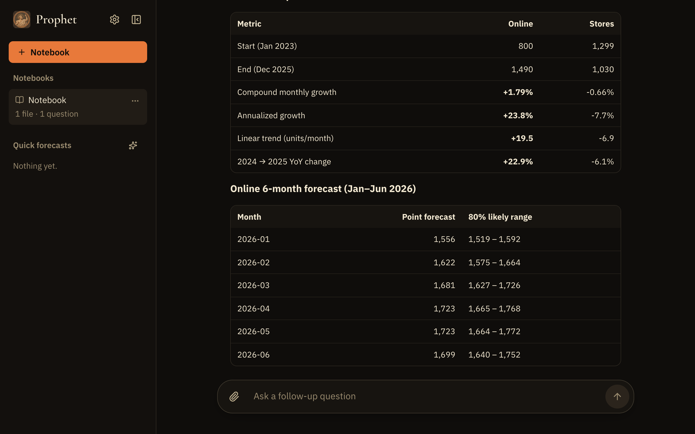
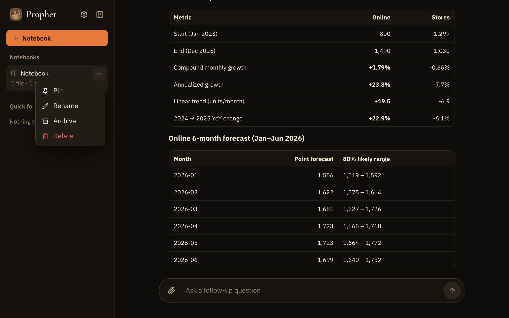
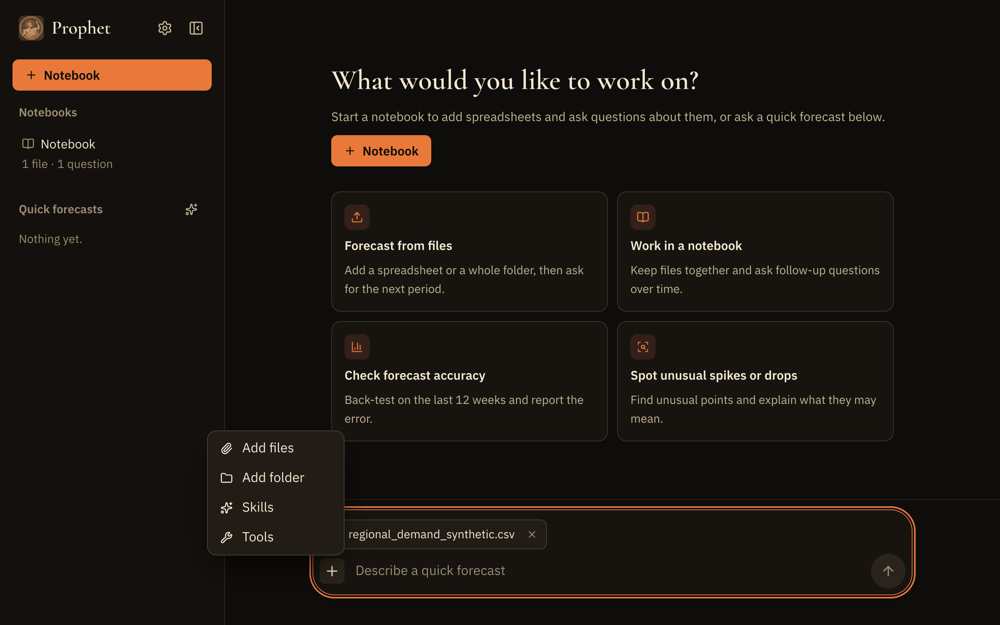
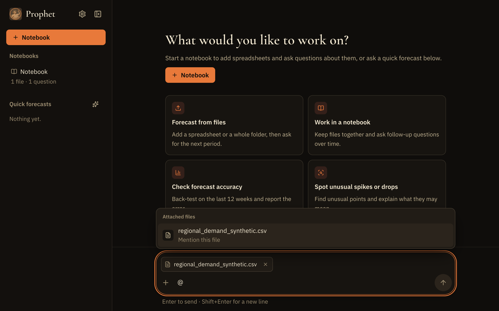
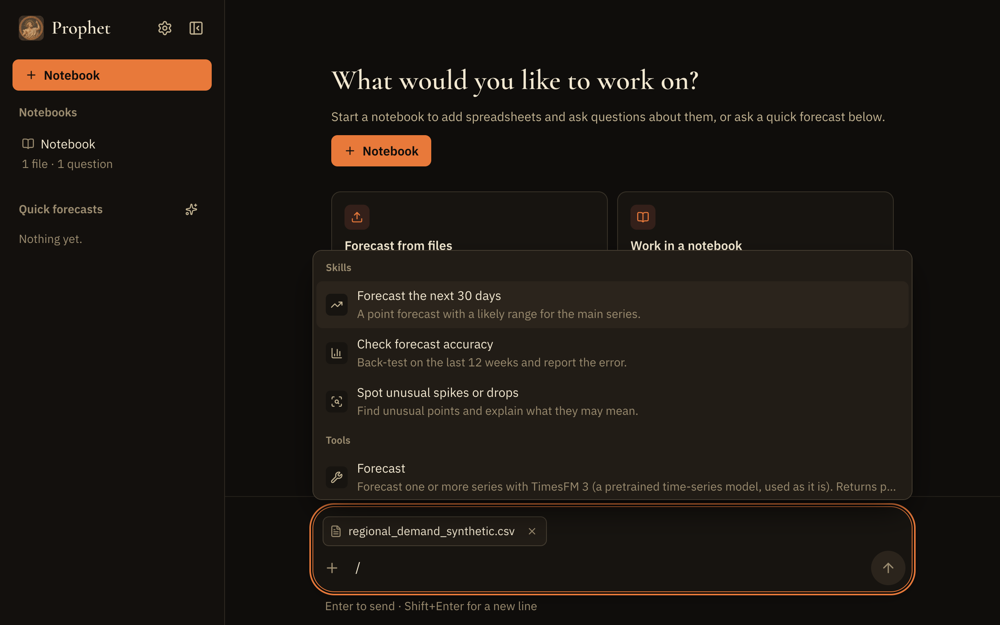
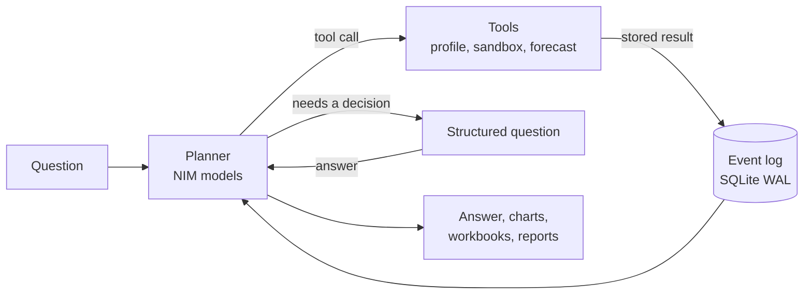

<p align="center">
  
</p>

<h1 align="center">Prophet</h1>

<p align="center">
  <strong>Ask your spreadsheets questions in plain language. Get checked numbers, charts and forecasts you can audit.</strong>
</p>

<p align="center">
  
  
  
  
  
</p>

<p align="center">
  
</p>

## Why Prophet

- **Answers show their working.** Every answer keeps the steps, the code that ran and what it printed. Nothing is a bare number.
- **Forecasts earn their place.** Each forecast is backtested against simple baselines on your own history, so you can see whether the model beats a naive guess.
- **Runs on your machine.** The server listens on loopback only. Your files stay local; the only outbound calls are planner requests to NVIDIA NIM.

## Features

### Ask in plain language

Drop in one or more spreadsheets and ask. Totals, comparisons, trends, joins across files and cleaning all work from the same notebook, which remembers its files and earlier answers.

Supported inputs: CSV, Excel (`xlsx`, `xlsm`, `xlsb`, `xls`), OpenDocument, Parquet and zipped bundles. Hidden sheets, title rows, merged headers and several tables on one sheet are detected and reported, never silently guessed. A damaged or password-protected file is flagged in words, not dropped.

<p align="center"></p>

### Forecasts with a baseline check

TimesFM 3 produces a point forecast and an 80% likely range. Prophet also scores the same method against a naive baseline on the last windows of your history, and says so when the model does not win.

<p align="center"></p>

### Organised workspace

Notebooks and quick forecasts live in the sidebar. Each one has a menu to pin, rename, archive or delete. Titles are generated from your question, then refined by a model in the background.

<p align="center"></p>

### Attach files, mention them, pick skills

Use **+** to add files, a whole folder, skills or tools. Type **@** to mention an attached file, or **/** to start a skill: a prompt you can adjust before sending.

<p align="center">
  
  &nbsp;
  
</p>

<p align="center"></p>

### Charts that make one point

Titles state the finding, bars start at zero, lines are labelled directly and the colours are colour-blind safe. The numbers behind every chart are saved beside it.

### Large files

CSV and Parquet files too big to read whole are queried where they sit. Only a small result comes back; totals come from the full file.

### Keep what matters

Cleaned tables are saved as versions you can download as CSV and reuse in later questions. Forecast packs come as PNG and SVG charts, an XLSX workbook, a DOCX report and a PDF, all listed with a SHA-256 manifest.

### Use it from other agents

Claude, Cursor, ChatGPT-style tools and scripts can drive Prophet over HTTP or MCP. See [API.md](API.md).

## Quick start

**Requirements**

- Python 3.12 and [uv](https://docs.astral.sh/uv/)
- Node.js, to build the web console
- An NVIDIA NIM API key, for the planner
- Apple silicon: the TimesFM 3 runtime is installed through MLX (`timesfm[mlx]`), so the install needs it.

**Install and run**

```bash
uv venv --python 3.12 .venv && source .venv/bin/activate && uv pip install -e ".[dev]"
cp .env.example .env              # add at least one NVIDIA_NIM_API_KEY_n
(cd web && npm install && npm run build)
PYTHONPATH=src python -m prophet_agent.api
```

Open <http://127.0.0.1:8010>, choose **Notebook**, attach a file and ask a question.

The port is set by `PROPHET_API_PORT`. Data lives in `data/` by default; set `PROPHET_HOME` to move it, for example to try Prophet on a scratch folder.

## How it works



A durable goal loop plans, acts and evaluates. Each model decision and tool result is stored before the run moves on, so an interrupted run resumes without asking the model again for finished work, and a finished tool call is never repeated. Analytics code runs in a restricted child process with read-only inputs and a time limit; everything it writes is listed with a checksum.

## Project layout

| Area | Location |
|---|---|
| Model access, key pool, failover, schema-bound output | `src/prophet_agent/nim/` |
| Durable runtime, event log, ledger, questions | `src/prophet_agent/runtime/` |
| Notebooks, sources, kept tables | `src/prophet_agent/notebooks.py` |
| Forecast maths and TimesFM 3 | `src/prophet_agent/forecast/` |
| Tools the agent calls | `src/prophet_agent/tools/` |
| Sandboxed analytics and artefacts | `src/prophet_agent/sandbox/`, `src/prophet_agent/artifacts/` |
| Versioned prompt contracts | `src/prophet_agent/prompts/` |
| HTTP API and MCP bridge | `src/prophet_agent/api/`, `src/prophet_agent/mcp_server.py` |
| Web console | `web/` |

## Documentation

- [API.md](API.md): HTTP routes and the MCP server.
- [docs/prophet/ARCHITECTURE.md](docs/prophet/ARCHITECTURE.md): locked design decisions, including the licence gate.
- [docs/prophet/GOAL.md](docs/prophet/GOAL.md): completion criteria and the evidence behind them.

## Development

```bash
scripts/check.sh            # offline gate: unit and API tests, no real model
scripts/check.sh --real     # also the real TimesFM 3 tests (Apple silicon, cached weights)
cd web && npx tsc --noEmit && npm run build
```

Please run the offline gate and the web typecheck before opening a pull request. [CLAUDE.md](CLAUDE.md) has the working conventions used in this repository.

## Licence and notices

- **Project licence:** not yet chosen. The repository has no licence file, so the code is not licensed for reuse until one is added.
- **TimesFM 3 weights** are released for non-commercial research use. Do not use outputs for commercial decisions, client deliverables or paid services. The licence gate is in [docs/prophet/ARCHITECTURE.md](docs/prophet/ARCHITECTURE.md).
- **Analytics sandbox:** a guardrail, not isolation. Open only files you trust.
- **Examples:** the screenshots use a synthetic dataset, and figures from the built-in data generator are synthetic.
