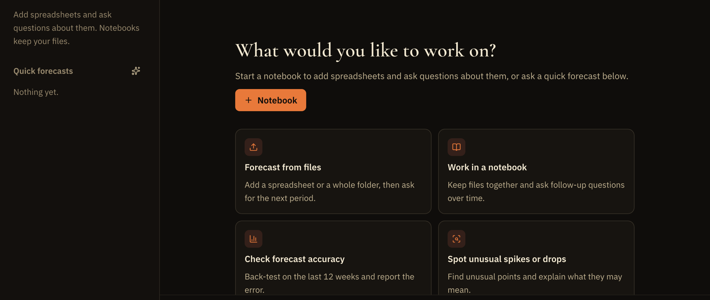

<p align="center"></p>

<h1 align="center">Prophet</h1>

<p align="center"><strong>Ask your spreadsheets anything. Forecast what comes next.</strong></p>

<p align="center">
  
  
  
  
  
  
  
</p>

Prophet is a local analyst you talk to. Drop in any number of spreadsheets, ask questions in plain language, clean and reshape the data, and forecast with TimesFM 3. It shows its working, cites where every number came from, asks when something is genuinely ambiguous, and hands you charts, workbooks and reports.

<p align="center"></p>
<p align="center"><sub>Screenshot of the start screen. Data shown in the examples is synthetic, not observed.</sub></p>

## What you can do

- **Add any spreadsheet.** CSV, Excel (`xlsx`, `xlsm`, `xlsb`, `xls`), OpenDocument, Parquet and zipped bundles. Several files at once. Hidden sheets, title rows, merged headers and several tables on one sheet are detected and reported, never silently guessed. A damaged or password-protected file is flagged in words, not dropped.
- **Keep asking.** Totals, comparisons, trends, anomalies, joins across files, cleaning. A notebook remembers its files and earlier answers, so "now split that by product" just works.
- **Forecast properly.** TimesFM 3 with likely ranges, backtested against simple baselines on your own history so you can see whether the model earns its keep. Intermittent demand, holidays, spikes and short histories are handled as questions to answer, not rules baked in.
- **Charts that make one point.** Titles state the finding, bars start at zero, lines are labelled directly, colours are colour-blind safe, and the plotted numbers are saved beside every chart.
- **Large files.** CSV and Parquet files too big to read whole are queried where they sit, so only a small result comes back; totals come from the full file.
- **See the working.** Each answer folds the steps behind it. Open them to read the code that ran and what it printed.
- **Keep what matters.** Cleaned tables are saved as versions you can download as CSV and reuse in later questions.
- **Use it from other agents.** Claude, Cursor, ChatGPT-style tools and scripts can drive Prophet over HTTP or MCP. See [API.md](API.md).

## Quick start

```bash
uv venv --python 3.12 .venv && source .venv/bin/activate && uv pip install -e ".[dev]"
cp .env.example .env            # add your NVIDIA NIM key(s)
(cd web && npm install && npm run build)
PYTHONPATH=src python -m prophet_agent.api
```

Open <http://127.0.0.1:8010>, press **New notebook**, drop files in, and ask.

Apple silicon is needed for the bundled TimesFM 3 runtime (`timesfm[mlx]`). The server listens on loopback only.

## How it works

A durable goal loop plans, acts and evaluates. Each model decision and tool result is stored before the run moves on, so an interrupted run resumes without asking the model again for finished work, and a finished tool call is never repeated. Analytics code runs in a restricted child process with read-only inputs and a time limit; everything it writes is listed with a checksum. Questions to you use a structured, answerable-in-a-click format.

| Layer | Where |
|---|---|
| Model access, key pool, failover, schema-bound output | `src/prophet_agent/nim/` |
| Durable runtime, ledger, questions, cancel | `src/prophet_agent/runtime/` |
| Notebooks, sources, kept tables | `src/prophet_agent/notebooks.py` |
| Forecast maths and TimesFM 3 | `src/prophet_agent/forecast/` |
| Tools the agent calls | `src/prophet_agent/tools/` |
| Sandboxed analytics and artefacts | `src/prophet_agent/sandbox/`, `src/prophet_agent/artifacts/` |
| Versioned prompt contracts | `src/prophet_agent/prompts/` |
| HTTP API and MCP bridge | `src/prophet_agent/api/`, `src/prophet_agent/mcp_server.py` |
| Console | `web/` |

## Documentation

- [API.md](API.md): HTTP routes and the MCP server, for driving Prophet from other agents.
- [docs/prophet/ARCHITECTURE.md](docs/prophet/ARCHITECTURE.md): locked decisions, including the licence gate.
- [docs/prophet/GOAL.md](docs/prophet/GOAL.md): completion criteria and the evidence behind them.
- [CLAUDE.md](CLAUDE.md): working guidance for Claude Code in this repository.

## Develop

```bash
scripts/check.sh            # offline gate (no real model)
scripts/check.sh --real     # also the real TimesFM 3 tests (cached weights)
cd web && npx tsc --noEmit && npm run build
```

## Notices

Prophet is an R&D tool. The TimesFM 3 weights are released for non-commercial research use: do not use outputs for commercial decisions, client deliverables or paid services. The analytics sandbox is a guardrail, not isolation; only open files you trust. Figures from the synthetic data generator are synthetic and are labelled as such wherever they appear. Full terms and the licence gate are in [docs/prophet/ARCHITECTURE.md](docs/prophet/ARCHITECTURE.md).
